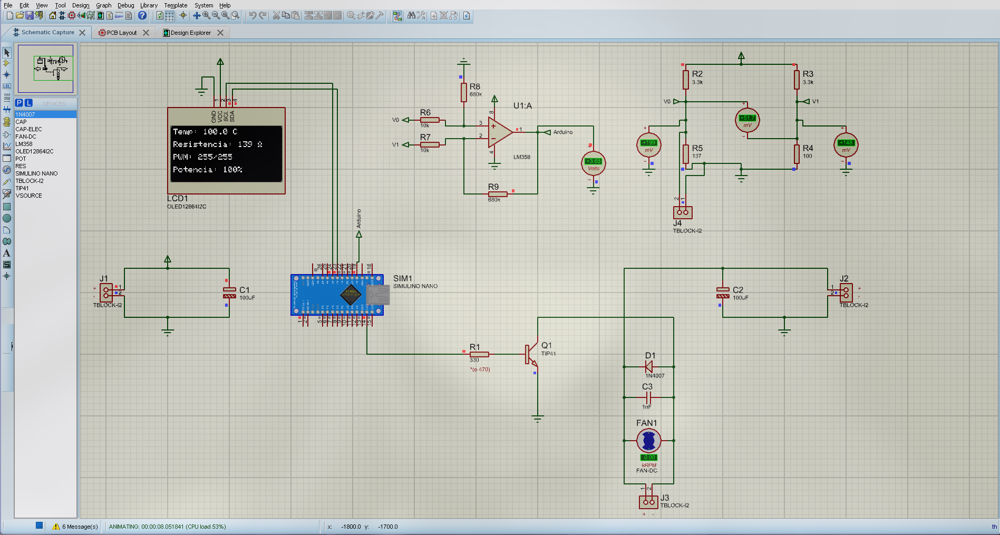
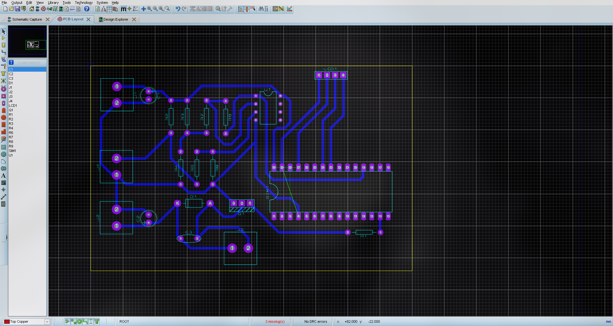
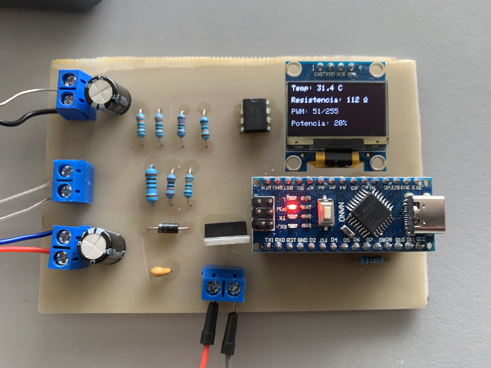
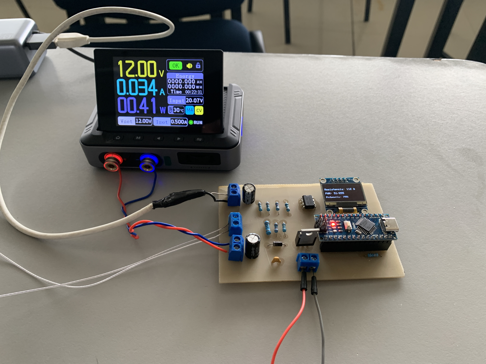

# Práctica No. 4 — Control de temperatura con PT100 y PWM

**UNIVERSIDAD DE GUADALAJARA**  
**CENTRO UNIVERSITARIO DE LOS VALLES (CUVALLES)**  
*División de Ingenierías | Departamento de Ciencias Computacionales e Ingenierías*

---
### Información General
- **Reporte Integrador de Práctica de Ingeniería:** Diseño Electrónico Asistido por Computadora
- **Materia / Asignatura:** Diseño Electrónico asistido por computadora
- **Profesor / Maestro:** Dr. Erasmo Misael Rentería Vargas
- **Carrera / Licenciatura:** Ingeniería en electrónica y computación
- **Semestre y Grupo:** 6° Semestre
- **Fecha de Entrega:** 6 de Noviembre de 2026

**Integrantes:**
- **Jonathan Rafael Arreola Ramírez** | [@Jonath-679](https://github.com/Jonath-679)
- **Juan Carlos Resendiz Camacho** | [@JuankaResendiz](https://github.com/JuankaResendiz)

---

## Índice de Contenido
1. [Resumen](#1-resumen)
2. [Objetivos de la Práctica](#2-objetivos-de-la-práctica)
3. [Marco Teórico y Fundamentos](#3-marco-teórico-y-fundamentos)
4. [Materiales del Circuito](#4-materiales-del-circuito)
5. [Materiales para Crear la PCB](#5-materiales-para-crear-la-pcb)
6. [Desarrollo, Simulación y Diseño de PCB](#6-desarrollo-simulación-y-diseño-de-pcb)
7. [Análisis de Resultados](#7-análisis-de-resultados)
8. [Conclusiones](#8-conclusiones)

---

## 1. Resumen

En este documento se presenta la elaboración de la práctica número 4, en donde se nos plantean los requerimientos del sistema y nosotros tendremos que realizar un diseño propio. A grandes rasgos, tendremos que realizar una PCB que detecte la temperatura a través del sensor PT100, y en base a eso controlar las revoluciones o la potencia de giro de un ventilador mediante un microcontrolador y adicionalmente mostrar en un display la información del sistema (temperatura, resistencia, potencia del ventilador y nivel de PWM).

---

## 2. Objetivos de la Práctica

### 2.1 Objetivo General
Diseñar un circuito para controlar las revoluciones o la potencia de un ventilador con base en la temperatura que detecta un sensor PT100, para posteriormente realizar el diseño de una PCB por método de planchado y montar el circuito para finalmente ver su funcionamiento en físico.

### 2.2 Objetivos Específicos
- Aprender las bases de cómo funciona un sistema que autorregula su temperatura.
- Aprender el funcionamiento del sensor PT100 y cómo leerlo desde un microcontrolador.
- Aprender a investigar y diseñar un circuito por nuestra cuenta a partir de ciertos requerimientos.
- Diseñar circuitos electrónicos mediante software.
- Diseñar y realizar una PCB con el método de planchado.
- Comprender el funcionamiento del circuito.

---

## 3. Marco Teórico y Fundamentos

El sensor PT100 es un RTD de platino con una resistencia de $R_0 = 100\ \Omega$ a $0\ ^\circ\text{C}$. Su comportamiento lineal en el rango de $0\ ^\circ\text{C}$ a $100\ ^\circ\text{C}$ sigue la ecuación:

$$R(T) = R_0(1 + \alpha T)$$

Donde $\alpha = 0.003851\ ^\circ\text{C}^{-1}$, lo que otorga una sensibilidad constante de $0.3851\ \Omega/^\circ\text{C}$.

Para evitar errores por efecto Joule ($P = I^2R$), la corriente del sensor se limita a $I < 1.5\ \text{mA}$ dimensionando las resistencias superiores del circuito.

### Acondicionamiento Analógico (Puente de Wheatstone y LM358)

La variación de resistencia $\Delta R$ se convierte a voltaje y se amplifica para adaptarla al rango dinámico del ADC. El puente de Wheatstone transforma el cambio de resistencia en un voltaje diferencial $\Delta V = V_B - V_A$:

$$V_A = V_{CC} \cdot \left(\frac{R_3}{R_1 + R_3}\right), \quad V_B(T) = V_{CC} \cdot \left(\frac{R_{PT100}(T)}{R_2 + R_{PT100}(T)}\right)$$

Con $R_1 = R_2 = 3.3\ \text{k}\Omega$ y $R_3 = 100\ \Omega$, el puente queda en equilibrio a $0\ ^\circ\text{C}$ ($\Delta V = 0\ \text{V}$).

**Amplificador Diferencial (LM358):** Aplica una ganancia en modo diferencial $A_v$:

$$V_{out} = A_v \cdot (V_B - V_A) = \left(\frac{R_f}{R_{in}}\right) \cdot \Delta V$$

### Restricciones del LM358 (Fuente Simple 5V / GND)

1. Al no implementar o disponer en el diseño una fuente negativa, los diferenciales negativos se saturan en $\approx 0\ \text{V}$. Esto quiere decir que el circuito no es capaz de medir temperaturas $< 0\ ^\circ\text{C}$ (bajo cero), por lo que el sistema marcará $0\ ^\circ\text{C}$. Esto pudiera parecer un defecto serio en el sistema, pero recordando que el objetivo final es regular la potencia del ventilador que enfriará el sistema acorde a la temperatura, no tiene mucho sentido encenderlo si la temperatura está bajo cero.
2. **Saturación Superior ($V_{OH}$):** Al no ser Rail-to-Rail, la salida máxima se limita a $V_{out,max} \approx V_{CC} - 1.3\ \text{V} \approx 3.7\ \text{V}$. Por lo tanto, la temperatura máxima que se puede medir es de $100\ ^\circ\text{C}$; superando esto el sistema seguirá marcando $100\ ^\circ\text{C}$. Así se decidió a fines de que la práctica fuera fácil y viable de probar.

### Procesamiento Digital y Filtrado

**Conversión ADC (10 bits):** El microcontrolador cuantiza la tensión analógica. Se combina un filtro pasa-bajos analógico $RC$ en la entrada del ADC ($f_c = \frac{1}{2\pi RC}$) con un promediado por software de 50 muestras para eliminar picos por conmutación electromagnética.

### Control PWM y Etapa de Potencia

**Modulación por Ancho de Pulso (PWM):** Varía el voltaje promedio aplicado al ventilador mediante el ciclo de trabajo. El registro PWM del Arduino Nano va de (0 a 255). Para esta práctica se discretizó el valor del PWM en base a la temperatura, esto para que el salto entre un "estado" y otro se haga más evidente, así que cada $20\ ^\circ\text{C}$ de aumento hace que el PWM incremente 20% más (+51 de PWM).

**Protección Inductiva (Diodo Flyback):** Durante el apagado del MOSFET, la inductancia del motor genera un pico de sobre-tensión inverso ($v_L = L \frac{di}{dt}$). El diodo en anti-paralelo re-circula la corriente y previene la ruptura del semiconductor.

---

## 4. Materiales del Circuito

| Elemento / Equipo | Función en la práctica | Cantidad |
| :--- | :--- | :---: |
| Arduino Nano | Pieza central del circuito que conecta la parte de sensor, ventilador y display | 1 |
| Bornera azul de 2 entradas | Facilita las conexiones con periféricos y alimentación | 4 |
| Resistencia $330\ \Omega$ | Resistencia de base para el transistor que controla el motor | 1 |
| Capacitor electrolítico $100\ \mu\text{F}$ | Estabiliza y limpia las señales de alimentación | 2 |
| Display OLED 128x64 I2C | Muestra visualmente la información del sistema en tiempo real | 1 |
| Ventilador 12V DC | Controlar la temperatura del sistema | 1 |
| Sensor PT100 2 hilos | Medir (en resistencia) la temperatura del sistema | 1 |
| Capacitor Cerámico $100\ \text{nF}$ | Limpiar el ruido eléctrico que genera el ventilador | 1 |
| Diodo 1N4007 | Diodo *Flyback* para el ventilador | 1 |
| LM358 (OPAMP) | Amplificar la señal que viene del puente de Wheatstone | 1 |
| Resistencia $10\ \text{k}\Omega$ | Parte del circuito del OPAMP | 2 |
| Resistencia $680\ \text{k}\Omega$ | Parte del circuito del OPAMP | 2 |
| Resistencia $3.3\ \text{k}\Omega$ | Parte del circuito del puente de Wheatstone | 2 |
| Resistencia $100\ \Omega$ | Parte del circuito del puente de Wheatstone | 1 |
| "Pin Header" tipo hembra | Para evitar tener que soldar el Arduino y display a la PCB | Tira de 50 |

---

## 5. Materiales para Crear la PCB

- Placa de cobre fenólica/baquelita
- Impresión del diseño en papel fotográfico o couché (realizada con impresora láser)
- Plancha doméstica (sin vapor)
- Cloruro férrico (ácido férrico)
- Alcohol isopropílico, acetona pura y lugar para lavar los utensilios
- Recipiente plástico o de vidrio
- Pinzas plásticas
- Minitaladro (Dremel) con brocas para PCB (0.6mm - 1.2mm)
- Kit de soldadura (electrónica)

---

## 6. Desarrollo, Simulación y Diseño de PCB

Antes de haber realizado el diseño de la PCB, montamos y probamos el diseño en una *protoboard*. Como aún no teníamos el sensor PT100, colocamos en su lugar un potenciómetro ya que el sensor PT100 es en sí una resistencia variable. Una vez que el circuito funcionaba entonces procedimos con el diseño de la PCB para finalmente imprimir el diseño y realizar el planchado, sumergir en ácido, perforar y soldar los componentes.

### Esquemático y Simulación

### Diseño de la PCB (Layout)

---

## 7. Análisis de Resultados

Tal como en la *protoboard*, el circuito funcionó excelentemente en la PCB. No hubo complicaciones mayores o imprevistos importantes al realizar la práctica. De esta forma la práctica se concluye con éxito.

| Circuito en funcionamiento (Display OLED) | Medición de consumo y alimentación |
| :---: | :---: |
|  |  |

---

## 8. Conclusiones

- **Jonathan Rafael Arreola Ramírez:** Esta práctica fue interesante ya que como fue diseño libre, esta vez no tuvimos un diseño del cual inspirarnos o tomar como base, nos tocó investigar cómo realizar el circuito para que cumpliera con los requerimientos, sobre todo la parte de aplicar un puente de Wheatstone y utilizar un OPAMP para poder leer correctamente el sensor PT100.

- **Juan Carlos Resendiz Camacho:** Esta práctica en lo personal me pareció muy interesante debido a que implicaba combinar conocimientos que ya teníamos sobre electrónica analógica, digital y la parte de potencia. Todo lo anterior con el fin de poder controlar variables físicas, pero lo que más me gustó es que durante el diseño del circuito aprendí cosas que no sabía como la función de un puente de Wheatstone y cómo se integraba con el sensor y el amplificador.
